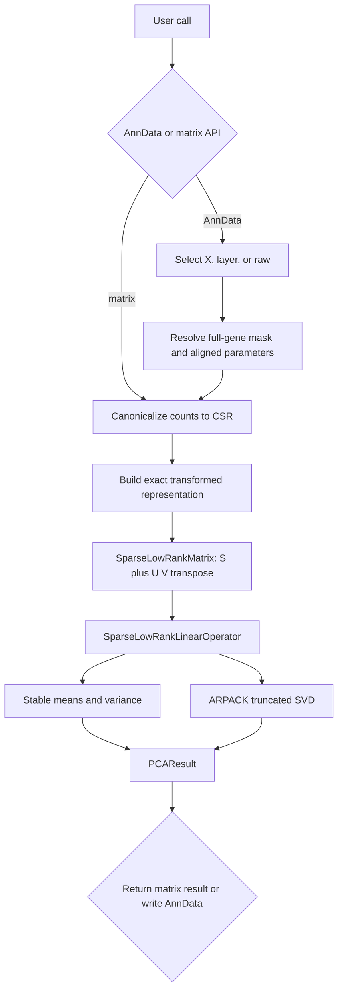
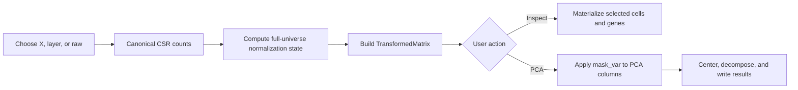
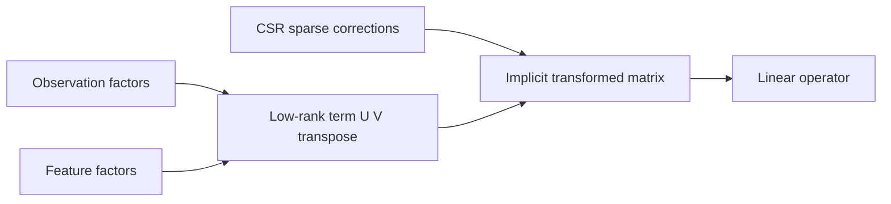
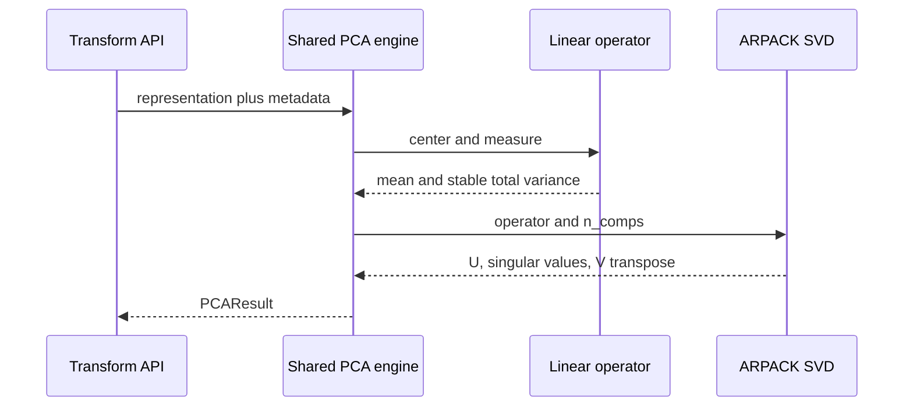

# Architecture

This is a guided code-reading path for contributors and reviewers of
`sparse-count-pca`. It emphasizes
the contracts that make the package exact and memory-efficient, then links to
the implementation and the tests that enforce each contract.

## Suggested reading order

1. [Public surface](#1-public-surface)
2. [Input and AnnData boundary](#2-input-and-anndata-boundary)
3. [Transform construction](#3-transform-construction)
4. [Sparse-plus-low-rank representation](#4-sparse-plus-low-rank-representation)
5. [Linear operator and numerical statistics](#5-linear-operator-and-numerical-statistics)
6. [Shared PCA execution](#6-shared-pca-execution)
7. [Correspondence analysis](#7-correspondence-analysis)
8. [Test and oracle strategy](#8-test-and-oracle-strategy)
9. [Review checklist](#9-review-checklist)

The normative mathematical contract is the
[package specification](specification.md).

The name describes the public contract rather than the implementation:
"count" covers single-cell, spatial, and general contingency-table inputs;
"PCA" is the primary analysis; and "sparse" states the scalability target.
Correspondence analysis remains as one closely related spectral method. The
linear-operator machinery stays private.

## System overview



The central boundary is the representation. Transform code decides what
matrix is being analyzed. The operator and SVD code know only how to multiply,
center, measure, and decompose `S + U @ V.T`.

### Bounded computation budgets

There are seven internal size controls and one public materialization default.
Their units differ because each operation creates different temporary arrays.

| Operation | Control | Default | Unit |
| --- | --- | ---: | --- |
| Count validation and margins | `_COUNT_CHECK_BLOCK_SIZE` | 100,000 | Stored entries; complete CSR rows for cell totals |
| Log construction | `_LOG_TRANSFORM_BLOCK_NNZ` | 100,000 | Nonzeros in complete CSR rows |
| Statistics means | `_STATS_MEAN_BLOCK_NNZ` | 1,000,000 | Nonzeros in complete CSR rows |
| Statistics norms | `_STATS_NORM_BLOCK_NNZ` | 100,000 | Nonzeros in complete CSR rows |
| Dense statistics reconstruction | `_STATS_DENSE_BATCH_VALUES` | 262,144 | Represented dense values |
| Residual construction | `_RESIDUAL_SUPPORT_BLOCK_SIZE` | 1,000,000 | Nonzeros in complete CSR rows |
| Clipping candidates | `_CANDIDATE_CHUNK_SIZE` | 65,536 | Candidate columns per row |
| Explicit materialization | `materialize(block_size=...)` | 1,024 | Selected observation rows |

Complete-row targets allow a single longer row to exceed the target. Dense
statistics batches similarly allow at least one column of the current row
block. The shared `_sparse._support_row_blocks` helper supplies row boundaries;
it has no additional default budget.

These budgets bound arithmetic scratch over stored entries, not total memory.
Total memory also depends on:

- input and transformed storage, and per-cell and per-gene vectors that scale
  with the matrix dimensions;
- sparse matrices allocated by dense-to-CSR conversion, canonicalization
  copies, and column selection for a variable mask;
- transformed storage, which one-step PCA holds for the whole decomposition;
- the isolated copy that an operator retained from a live `TransformedMatrix`
  requires;
- index storage, which structure sharing saves only where the input support is
  compatible (see [log and CLR family](#log-and-clr-family)).

Other pages refer to these controls by name rather than restating their
defaults. All budgets balance temporary memory against
Python dispatch. The dense statistics batch sits near the runtime plateau of a
small synthetic sweep; see the
[batch-size measurements](testing.md#operator-batch-size-measurements). Means
use larger blocks than norms because the norm path needs more temporary arrays
per entry. See [testing strategy](testing.md) for the measurement protocols.

## 1. Public surface

Start with [`src/sparse_count_pca/__init__.py`](https://github.com/jgarthur/sparse_count_pca/blob/main/src/sparse_count_pca/__init__.py).
It exports complete one-step analyses plus an explicit two-step transform API:

- residual PCA: `residual_pca`, `residual_pca_matrix`;
- size-factor-normalized log1p: `log1p_norm_pca` and its matrix variant;
- count-scale CLR: `shifted_clr_pca` and its matrix variant;
- composition-scale CLR: `proportion_shifted_clr_pca` and matrix variant;
- prior-count transforms: `dirichlet_log_pca`, `dirichlet_clr_pca` and matrix
  variants;
- correspondence analysis;
- transform specifications and `transform`;
- `TransformedMatrix`, `PCAResult`, and `CorrespondenceAnalysisResult`.

`TransformedMatrix` is an uncentered SciPy `LinearOperator` backed by an exact
sparse-plus-low-rank representation. It supports block materialization and PCA.
The named one-step PCA functions build the same transform and immediately run
PCA. Correspondence analysis stays separate because masking changes its table
margins and its coordinate semantics differ from PCA.

Questions to ask during review:

- Is every public name sufficient to identify the mathematical transform?
- Are scientifically meaningful parameters explicit rather than inferred?
- Does each AnnData API have a matching matrix API?
- Is anything private being relied on as if it were public?

## 2. Input and AnnData boundary

Read these files together:

- [`_counts.py`](https://github.com/jgarthur/sparse_count_pca/blob/main/src/sparse_count_pca/_counts.py): count canonicalization and
  boolean-mask validation shared by every analysis;
- [`_anndata.py`](https://github.com/jgarthur/sparse_count_pca/blob/main/src/sparse_count_pca/_anndata.py): count-source selection,
  mask resolution, and generic PCA result writing;
- [`_transform.py`](https://github.com/jgarthur/sparse_count_pca/blob/main/src/sparse_count_pca/_transform.py): public transform
  specifications, implicit matrix products, materialization, and two-step PCA;
- [`_residual_pca.py`](https://github.com/jgarthur/sparse_count_pca/blob/main/src/sparse_count_pca/_residual_pca.py): residual-specific
  parameter alignment and both residual PCA entry points.

The important ordering is:



`mask_var` is a PCA feature selector, not a normalization-universe selector.
For example, CLR row means, Dirichlet prior normalization, cell totals, and
residual gene proportions are computed before the mask is applied. Excluded
genes receive `NaN` loadings when results are written back to AnnData.

The current transform backend stores an in-memory CSR sparse correction. Its
public contract is instead `LinearOperator` multiplication and block
materialization so a later backed implementation can stream observation blocks.
Variable-wide access warns because CSR must scan rows; `out=` avoids requiring a
second full dense allocation when users explicitly materialize the matrix.

Useful tests:

- [`tests/test_residual_anndata.py`](https://github.com/jgarthur/sparse_count_pca/blob/main/tests/test_residual_anndata.py)
- [`tests/test_residual_scanpy.py`](https://github.com/jgarthur/sparse_count_pca/blob/main/tests/test_residual_scanpy.py)
- mask-order tests in [`tests/test_log_pca.py`](https://github.com/jgarthur/sparse_count_pca/blob/main/tests/test_log_pca.py) and
  [`tests/test_dirichlet.py`](https://github.com/jgarthur/sparse_count_pca/blob/main/tests/test_dirichlet.py)

## 3. Transform construction

Transform builders return an exact `SparseLowRankMatrix`. They do not run PCA.

### Residual family

[`_residuals.py`](https://github.com/jgarthur/sparse_count_pca/blob/main/src/sparse_count_pca/_residuals.py) contains Poisson,
binomial, and size-factor-scaled negative-binomial Pearson and deviance
residual builders. For structural zeros, the residual baseline factorizes;
nonzero-count corrections are stored sparsely. Every residual builder evaluates
count support in bounded blocks and writes directly into the requested
representation dtype, so temporary float64 calculation arrays do not scale as
multiple copies of the full sparse support. Output support uses the same
`_csr_with_data` helper as the log family. Pruning computed zeros rewrites
indices and indptr in place, so clipped Pearson residuals and every deviance
residual own their support even when sharing is permitted; only unclipped
Pearson residuals can borrow it.

[`_clip.py`](https://github.com/jgarthur/sparse_count_pca/blob/main/src/sparse_count_pca/_clip.py) applies exact clipping. Symmetric
clipping may add sparse entries where structural-zero residuals cross the
lower threshold, so it has an explicit support-growth guard, reachable under
the clipped symmetric default. `_clip.py` also resolves the named thresholds
`"seurat"` and `"scanpy"` into numbers.

### Log and CLR family

[`_log_transforms.py`](https://github.com/jgarthur/sparse_count_pca/blob/main/src/sparse_count_pca/_log_transforms.py) contains the
shared algebra. Its primitive sparse correction is

```text
S_ij = log1p(X_ij / prior_count_j),
```

which is zero on structural zeros and therefore preserves sparse support.

The log builders allocate sparse data in the requested storage dtype and
evaluate corrections in float64 blocks of complete CSR rows sized by
`_LOG_TRANSFORM_BLOCK_NNZ`. Each wrapper supplies a function that gathers the
current block's divisors, so row divisors and vector prior counts are expanded
only for that block; a single longer CSR row can exceed the target. The shared
helper also returns float64 row sums taken from each block before its values
are cast, which the CLR builders use to fit row means at full precision.
Output support comes from `_sparse._csr_with_data`, which the residual
builders and scalar rescaling also use. It chooses int32 or int64 indices from
the shape and stored-entry count, the width SciPy's CSR constructor requires,
and copies indices and indptr once at that width. When the builder is called
with `share_structure=True`, input support that already has that width is
borrowed instead of copied; other widths are still copied. The public
`transform` exposes this as an opt-in. One-step analyses turn it on when they
do not return an operator, because the transformed matrix then lives only for
the duration of the call. `_transform.py` passes storage dtype into every log
builder, so `TransformedMatrix` can reuse the builder's sparse result rather
than casting a full float64 CSR.

For size-factor-normalized log1p, that sparse correction is the entire
transform: `build_log1p_norm_representation` divides each stored count by its
row's size factor, applies `log1p`, and returns the result with empty
rank-zero factors. Zeros map to zero, so there is no low-rank baseline to
carry, and only PCA centering later adds a rank-one term.

[`_log_pca.py`](https://github.com/jgarthur/sparse_count_pca/blob/main/src/sparse_count_pca/_log_pca.py) provides the
normalized-log1p, count-scale, and composition-scale PCA APIs.
[`_dirichlet_pca.py`](https://github.com/jgarthur/sparse_count_pca/blob/main/src/sparse_count_pca/_dirichlet_pca.py) provides the
prior-count parameterization and AnnData prior alignment.

| Transform | Shift domain | Representation rank | Empty cells |
| --- | --- | ---: | --- |
| size-factor-normalized log1p | normalized count | 0 | rejected by input policy |
| shifted CLR | fixed raw count | 1 | rejected by input policy |
| composition-scale shifted CLR | composition scale | 1 | rejected |
| Dirichlet log closure | prior counts | at most 2 | rejected by input policy |
| Dirichlet CLR | prior counts | at most 2 | rejected by input policy |

The defining cross-check is:

```text
shifted_clr(count_shift=a)
    == dirichlet_clr(concentration=n_vars * a, uniform prior).
```

### Residual and log transforms are separate families

Residuals are deviations from a fitted null mean. Log transforms construct
positive abundance coordinates. They share an execution engine, not a model
enum. This separation is intentional.

## 4. Sparse-plus-low-rank representation

Read [`_representation.py`](https://github.com/jgarthur/sparse_count_pca/blob/main/src/sparse_count_pca/_representation.py).

The sole representation is

```text
M = S + U @ V.T
```

with CSR `S`, dense factors `U` and `V`, and rank including zero. Column
selection and row/column scaling preserve this form.



Review the shape checks closely. Representation bugs tend to be inexpensive
to detect here and expensive to diagnose after ARPACK.

Useful tests:

- [`tests/test_operator.py`](https://github.com/jgarthur/sparse_count_pca/blob/main/tests/test_operator.py), especially ranks 0, 1,
  and 3;
- transform materialization tests in
  [`tests/test_log_pca.py`](https://github.com/jgarthur/sparse_count_pca/blob/main/tests/test_log_pca.py),
  [`tests/test_dirichlet.py`](https://github.com/jgarthur/sparse_count_pca/blob/main/tests/test_dirichlet.py), and
  [`tests/test_deviance.py`](https://github.com/jgarthur/sparse_count_pca/blob/main/tests/test_deviance.py).

## 5. Linear operator and numerical statistics

[`_operator.py`](https://github.com/jgarthur/sparse_count_pca/blob/main/src/sparse_count_pca/_operator.py) turns the representation
into a SciPy `LinearOperator`:

```text
A = S + U @ V.T - 1 @ mean.T
```

when PCA column centering is enabled.

The multiplication paths are straightforward; the numerically delicate part
is calculating means and Frobenius norms. Sparse corrections and low-rank
baselines can be individually large and nearly cancel. The implementation
therefore computes actual represented values on stored support and treats
sparse and nearly dense columns differently instead of subtracting large
component norms. The precise mean and squared-norm contracts are specified in
[Explained variance and total variance](specification.md#explained-variance-and-total-variance).

Rank-zero operators compute statistics directly from bounded CSR blocks.
Centered operators accumulate sums and stored counts in the mean pass, then
sum stored squared deviations and add implicit-zero contributions analytically.
Center subtraction uses the operator dtype and squared sums use float64.
Uncentered operators need only a norm pass. Nonnegative log1p data avoid dense
reconstruction entirely. Dense-majority columns with negative stored values
use the batched direct `math.fsum` mean as a signed-sum backstop.

For nonzero-rank operators, the support terms are accumulated from bounded
blocks of complete CSR rows. Sparse-column corrections and nonnegative squared terms use vectorized
`float64` reductions over each block. Their low-order bits may depend on CSR
and block order under severe mixed-sign cancellation. Columns with more than
half their entries stored instead use direct represented values grouped by a
block-local CSC and reconstructed in bounded NumPy column batches. Each column
is contiguous in the dense batch. Direct means use `math.fsum`; direct norms
subtract the stored center in the operator dtype, then square and reduce
nonnegative deviations in `float64`. CSR row blocks are sized by
`_STATS_MEAN_BLOCK_NNZ` and `_STATS_NORM_BLOCK_NNZ`. Column batches are
sized separately by `_STATS_DENSE_BATCH_VALUES`, counted as
`rows_in_block * columns`, or hold one column if the CSR row block alone
exceeds that target. That target bounds each dense buffer, with several
buffers live during statistics.

After the norm sweep, sparse columns whose result is too small relative to the combined support-replacement terms are recomputed directly in
a second sweep. Correspondence analysis uses this same bounded CSR path for
its uncentered statistics. Centered operators require one sweep for means
followed by one sweep that computes both uncentered and centered norms;
expanding centered squares from raw moments would save a pass but reintroduce
cancellation.

Pay particular attention to:

- operator dtype versus float64 summary-statistic dtype;
- the stored operator mean used by both multiplication and variance;
- the numerical-zero variance criterion before ARPACK;
- transpose multiplication and multi-vector paths.

The adversarial variance cases live in
[`tests/test_residual_pca.py`](https://github.com/jgarthur/sparse_count_pca/blob/main/tests/test_residual_pca.py).

## 6. Shared PCA execution

[`_pca.py`](https://github.com/jgarthur/sparse_count_pca/blob/main/src/sparse_count_pca/_pca.py) is the transform-independent PCA
engine. It validates dimensions and dtype, creates the centered operator,
checks variance, calls the SVD layer, calculates variance summaries, and
returns `PCAResult`.

When `return_operator=True` hands the centered operator back to the caller,
ownership decides whether its arrays are copied. An operator derived from a
live `TransformedMatrix` would otherwise share that object's arrays, and
through them any borrowed input support, so it takes a support-sized copy. A
one-step call such as `residual_pca_matrix` builds a representation nothing
else holds. When it returns the operator, it builds that representation with
owned support and passes those arrays directly, skipping the copy. When it
does not, it lets the representation borrow compatible count support, which
is safe because the operator does not outlive the call.

[`_svd.py`](https://github.com/jgarthur/sparse_count_pca/blob/main/src/sparse_count_pca/_svd.py) owns the narrow ARPACK contract:

- deterministic starting vector from `random_state`;
- descending singular-value order;
- scikit-learn-compatible sign flipping;
- float64 singular values even for a float32 operator.



This is the best place to review whether all PCA families report consistent
statistics and reproducibility metadata.

## 7. Correspondence analysis

[`_correspondence.py`](https://github.com/jgarthur/sparse_count_pca/blob/main/src/sparse_count_pca/_correspondence.py) uses the same
representation and operator machinery but is not ordinary column-centered
PCA. Classical CA reuses the stable Poisson Pearson representation with a
`1 / sqrt(grand_total)` scale. The explicitly experimental `model="scaled_nb"`
path substitutes scaled-NB Pearson residuals at the same total scaling. Both
report row and column principal coordinates and inertia; standard coordinates
are not stored because they are derivable as principal coordinates divided by
singular values.

Only the Poisson path has the classical chi-square and full barycentric
interpretations. The scaled-NB path retains observed count masses for
coordinate scaling and reports residual inertia.

Keep it out of generic PCA helpers unless an abstraction preserves its
different centering, scaling, result type, and coordinate semantics.

Reference coverage is in
[`tests/corral_reference/`](https://github.com/jgarthur/sparse_count_pca/tree/main/tests/corral_reference) and
[`tests/test_correspondence.py`](https://github.com/jgarthur/sparse_count_pca/blob/main/tests/test_correspondence.py).

## 8. Test and oracle strategy

The suite has four complementary layers:

1. shared independent dense formulas for small simulated matrices and the full
   real-data fixture;
2. operator product and stable-statistic checks;
3. dense SVD comparisons for singular values and subspaces;
4. pinned external provenance for literature/software compatibility.

Reference directories:

- [`tests/townes_reference/`](https://github.com/jgarthur/sparse_count_pca/tree/main/tests/townes_reference): residual PCA;
- [`tests/corral_reference/`](https://github.com/jgarthur/sparse_count_pca/tree/main/tests/corral_reference): correspondence
  analysis;
- [`tests/shifted_clr_reference/`](https://github.com/jgarthur/sparse_count_pca/tree/main/tests/shifted_clr_reference): current
  count-scale PFlog;
- [`tests/proportion_shifted_clr_reference/`](https://github.com/jgarthur/sparse_count_pca/tree/main/tests/proportion_shifted_clr_reference):
  historical composition-scale shifted CLR;
- [`tests/real_data_reference/`](https://github.com/jgarthur/sparse_count_pca/tree/main/tests/real_data_reference):
  deterministic observed-depth and equal-depth PBMC3k-derived fixtures,
  full-matrix coverage for every transform family, and a pinned SCTransform v2
  equality oracle.

Normal tests are offline. Regeneration tooling is provenance, not a runtime
dependency.

## 9. Review checklist

### Mathematical contracts

- Do structural-zero values have the claimed factorization?
- Does each sparse correction equal actual transformed value minus baseline?
- Are count, composition, and prior-count shift domains never conflated?
- Are CLR means computed over the intended full gene universe?
- Do correspondence-analysis margins use the selected contingency table?

### Numerical contracts

- Can large terms cancel in a new statistic?
- Does float32 describe the matrix actually passed to ARPACK?
- Are boundary cases evaluated with stable `log1p` or series forms?
- Does a zero-variance matrix fail before iterative decomposition?

### API contracts

- Are matrix and AnnData results semantically aligned?
- Are arrays aligned before masking?
- Does metadata contain enough state to reproduce the analysis?
- Are empty-cell and zero-gene behaviors explicit?
- Does a new transform deserve a named public function?

### Scalability contracts

- Is work `O(nnz + n_obs * rank + n_vars * rank)` where expected?
- Are support-sized temporaries duplicated?
- Can clipping or conversion unexpectedly densify?
- Can a downstream operation stream rows or columns instead of materializing?
